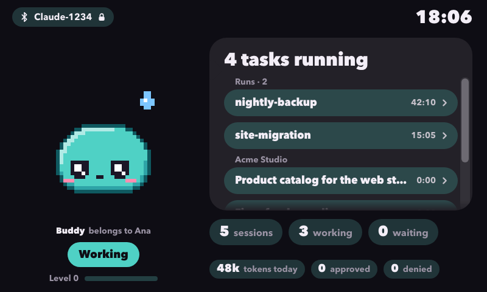
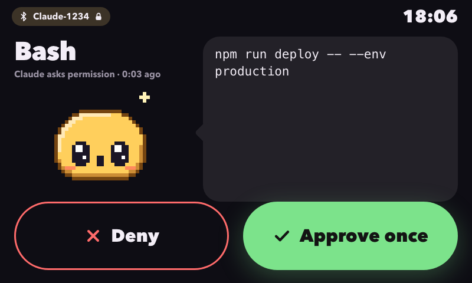
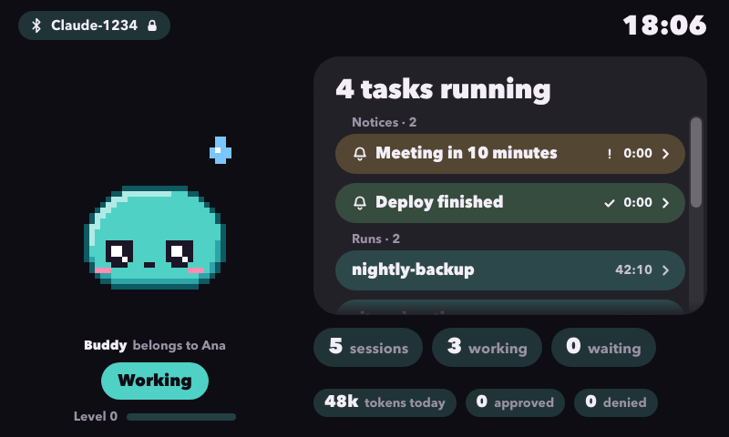
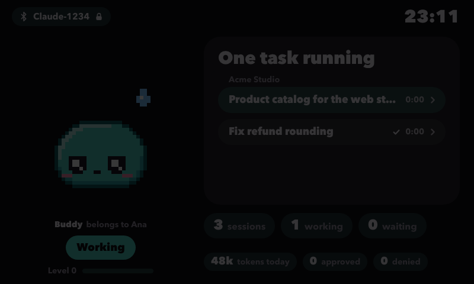

# Claude Buddy

[English](README.md) | **Español**

> Proyecto no oficial, sin relación con Anthropic ni aprobado por ella. "Claude" es una marca de Anthropic.

Un compañero con pantalla táctil para Claude desktop, hecho con una Raspberry Pi 4 y una pantalla de 7".

Aparece en Claude desktop como un **Hardware Buddy** por Bluetooth LE. Cuando Claude pide permiso para usar una herramienta, el pedido sale en la pantalla y lo **aprobás o denegás con un toque**. De un vistazo también ves qué hacen tus sesiones de Claude y tus corridas en segundo plano, y una mascota (Mochi) reacciona a todo eso.

Habla el mismo protocolo que el buddy oficial (M5StickC Plus), pero sobre **BlueZ y Python** en vez de un ESP32.



## Qué necesitás

- Una **Raspberry Pi 4** con **Raspberry Pi OS (64 bit) con escritorio** y el Bluetooth integrado. Con 2 GB alcanza.
- La **pantalla táctil oficial de 7"** (DSI, 800x480). Sin pantalla igual podés correr el buddy y contestar con el teclado.
- **Python 3.11 o más nuevo** (Pi OS Bookworm trae 3.11, Trixie trae 3.13) y **Chromium** (`sudo apt install chromium`).
- **Claude desktop** en un Mac o en una PC con Windows, con **Developer Mode** activado.
- Las funciones opcionales que leen tus sesiones (el hook de contexto, el censo) corren en macOS.

## Empezar (unos 10 minutos)

**1. Preparar el Pi.** Con Raspberry Pi Imager elegí *Raspberry Pi OS (64-bit)* con escritorio, poné el nombre de equipo `buddy`, creá tu usuario, activá SSH y, en la personalización, tu Wi-Fi. Encendelo con la pantalla conectada y asegurate de que el escritorio inicie sesión solo (`sudo raspi-config nonint do_boot_behaviour B4`). Instalá Chromium si falta.

**2. Pasar el proyecto al Pi e instalarlo.** Desde tu compu:

```bash
rsync -av --exclude .venv --exclude __pycache__ --exclude .pytest_cache ./ <usuario>@buddy.local:claude-buddy/
```

En el Pi:

```bash
cd claude-buddy
python3 -m venv .venv            # si se queja: sudo apt install python3-venv
.venv/bin/pip install -r requirements.txt
.venv/bin/python buddy.py check  # tiene que terminar con "BlueZ aceptó todo"; no deja nada corriendo
```

**3. Correr y emparejar.**

```bash
.venv/bin/python buddy.py
```

En Claude desktop: **Help > Troubleshooting > Enable Developer Mode**, después **Developer > Open Hardware Buddy…**, tocá **Connect** y elegí **`Claude-XXXX`** (las cuatro letras salen en la terminal del Pi). Si macOS pregunta por Bluetooth, permitilo. El Pi muestra un **código de 6 dígitos**, en grande en la pantalla y en la terminal; escribilo en el cuadro que abre tu compu. El emparejamiento se hace una sola vez, después reconecta solo.

**4. Abrir la pantalla.** En otra terminal del Pi (o por SSH):

```bash
./kiosk.sh        # Chromium a pantalla completa; sale con Alt+F4. Con ./kiosk.sh --window abre una ventana normal mientras ajustás cosas
```

**5. Que arranque solo con el Pi** (el daemon como servicio de usuario, la pantalla al iniciar sesión en Pi OS Trixie con labwc):

```bash
mkdir -p ~/.config/systemd/user ~/.config/labwc
cp claude-buddy.service ~/.config/systemd/user/
systemctl --user daemon-reload
systemctl --user enable --now claude-buddy
sudo loginctl enable-linger "$USER"      # arranca con el Pi, antes de que alguien inicie sesión
echo "$HOME/claude-buddy/kiosk.sh > $HOME/.cache/claude-buddy-kiosk.log 2>&1 &" >> ~/.config/labwc/autostart
```

Reiniciá para comprobarlo: el buddy anuncia a los ~20 segundos de encender y la pantalla aparece unos 10 segundos después. Pi OS arranca labwc con `-m`, así que ese archivo de autostart se **suma** al del sistema, no lo reemplaza. En Bookworm con wayfire la línea va en `~/.config/wayfire.ini`, sección `[autostart]` (según documentación, no probado). Comprobá que la pantalla no se apague: `sudo raspi-config nonint get_blanking` tiene que imprimir `1`; si no, `sudo raspi-config nonint do_blanking 1`.

Si en tu Pi BlueZ solo acepta al buddy con `sudo`, usá la versión de servicio de sistema de [docs/es/architecture.md](docs/es/architecture.md#correr-como-servicio-de-sistema).

## Qué ves y qué hacés


**Aprobar o denegar con un toque.** Un pedido de permiso de Claude desktop muestra la herramienta, el texto del pedido y dos botones grandes, **Denegar** y **Aprobar una vez**. Los botones se activan 0,6 segundos después de que aparece el pedido: un dedo que ya estaba apoyado no aprueba nada, y dos toques seguidos mandan una sola respuesta. Si contestás en otro lado (tu compu, el teclado), el pedido desaparece solo. El teclado también sirve: `a` aprueba, `d` deniega.



**Hilos.** Con el hook de contexto instalado (opcional, abajo), la burbuja lista qué conversaciones de Claude siguen vivas, cada una con su título real y agrupadas como la barra lateral de Claude desktop. Tocá una fila y leés lo último que dijo. Ver [docs/es/features/threads-and-context-hook.md](docs/es/features/threads-and-context-hook.md).

**Corridas.** Las corridas `claude -p` sin pantalla y los scripts que nombres salen en el grupo **Corridas**, con cuánto lleva corriendo cada una. Opcional, ver [docs/es/features/census.md](docs/es/features/census.md).

**Avisos.** Un script o un asistente puede dejar un mensaje corto en la pantalla con `tools/notify.py`; lo cerrás con un toque. Ver [docs/es/features/notices.md](docs/es/features/notices.md).



**Modo noche.** De 23:00 a 07:00 (la hora de tu compu) la pantalla baja su luz de verdad, la del backlight. Un toque la despierta 30 segundos y un permiso la despierta solo. Viene prendido; `--night off` lo apaga. Ver [docs/es/features/night-mode.md](docs/es/features/night-mode.md).



**Una mascota con ánimos.** Mochi duerme, está tranquilo, trabaja, te necesita, celebra, se marea y se pone contento, y sube de nivel cada 50.000 tokens de salida. Tocalo y sonríe; cinco toques rápidos lo marean. Un pack que mandes desde Claude desktop lo puede reemplazar. Ver [docs/es/features/pets-and-packs.md](docs/es/features/pets-and-packs.md).

| Pantalla | Cuándo |
|---|---|
| **Bluetooth no está listo** | bluetoothd parado, rfkill, sin adaptador. Dice por qué y reintenta solo |
| **Emparejar** | 6 dígitos grandes mientras la compu pide el código |
| **Claude pide permiso** | herramienta, texto del pedido, **Denegar** / **Aprobar una vez** (y **Siempre** para Claude Code en la terminal). `+1 en cola` si hay más esperando |
| **Conectado** | la mascota con su ánimo, sesiones / trabajando / esperando, tokens de hoy, nivel, hilos vivos, corridas, avisos |
| **Esperando a Claude desktop** | nadie conectado; recuerda el nombre `Claude-XXXX` |

Teclas en la terminal del Pi: `a` aprobar, `d` denegar, `s` estado, `u` olvidar emparejamientos (confirmás con `y`), `q` salir. Si hay varios pedidos en cola, `a` y `d` responden el más viejo primero.

## Funciones opcionales

Todo lo de esta sección es opcional. Sin nada de esto igual tenés emparejamiento, aprobación de permisos, la mascota y el modo noche.

### La API local (la usan los hooks, el censo, los avisos y Hermes)

Todo lo que viene de fuera de Claude desktop llega al Pi por una API HTTP chica en el puerto 8766, con su propio token. Está **apagada hasta que arrancás el daemon con `--hermes-bind`** (las opciones todavía se llaman "hermes" por razones históricas). Puede encolar pedidos de aprobación y mostrar información, pero nunca aprueba nada: eso solo lo hace un toque en la pantalla o una tecla en el Pi. Detalles en [docs/es/local-api.md](docs/es/local-api.md).

```bash
# en el Pi: un token que solo lea tu usuario, de 16 caracteres o más
mkdir -p ~/.config/claude-buddy
(umask 077; python3 -c 'import secrets; print(secrets.token_urlsafe(32))' > ~/.config/claude-buddy/hermes.token)

# arrancar con la API en la IP de Tailscale del Pi (o 0.0.0.0 para toda la LAN, no se recomienda)
.venv/bin/python buddy.py --hermes-bind <ip-de-tailscale> --hermes-token-file ~/.config/claude-buddy/hermes.token
```

Como servicio, agregá esas dos opciones al `ExecStart` de `claude-buddy.service`. En la compu donde corre Claude, copiá el mismo token sin que pase por la pantalla:

```bash
mkdir -p ~/.config/claude-buddy
(umask 077; ssh <usuario>@buddy.local cat .config/claude-buddy/hermes.token > ~/.config/claude-buddy/hermes.token)
```

Los clientes usan `http://buddy:8766` por defecto (el nombre del Pi en Tailscale). Si la API escucha en tu LAN, poné `CLAUDE_BUDDY_URL=http://buddy.local:8766`.

### Hook de contexto: qué conversaciones están vivas

Un hook de Claude Code que le cuenta al buddy qué hace cada sesión. Solo librería estándar, corre con el Python 3.9 que trae macOS. Agregalo a `~/.claude/settings.json` dentro de `"hooks"` (si ya tenés esas llaves, sumá el hook a cada una):

```json
{
  "hooks": {
    "PreToolUse": [
      {"matcher": "*", "hooks": [{"type": "command", "command": "/usr/bin/python3 \"$HOME/Projects/claude-buddy/tools/context_hook.py\" 2>/dev/null; exit 0", "timeout": 5}]}
    ],
    "UserPromptSubmit": [
      {"hooks": [{"type": "command", "command": "/usr/bin/python3 \"$HOME/Projects/claude-buddy/tools/context_hook.py\" 2>/dev/null; exit 0", "timeout": 5}]}
    ],
    "Stop": [
      {"hooks": [{"type": "command", "command": "/usr/bin/python3 \"$HOME/Projects/claude-buddy/tools/context_hook.py\" 2>/dev/null; exit 0", "timeout": 5}]}
    ],
    "SessionEnd": [
      {"hooks": [{"type": "command", "command": "/usr/bin/python3 \"$HOME/Projects/claude-buddy/tools/context_hook.py\" 2>/dev/null; exit 0", "timeout": 5}]}
    ]
  }
}
```

Dejá el `2>/dev/null; exit 0` del final de cada comando. Si el archivo del script desaparece (una carpeta movida, un backup restaurado), Python sale con código 2 y Claude Code lo lee como "bloquear", con lo que cada herramienta de cada sesión quedaría negada. El script siempre sale con 0, pero solo la línea de comando cubre un script que ni siquiera arranca.

El hook nunca frena una sesión: sale en silencio pase lo que pase, se rinde a los 1,5 s para conectar y a los 2 s esperando respuesta, y un temporizador lo termina a los 2,5 s pase lo que pase con la red. Si el buddy no contesta, lo deja en paz 30 segundos. Se apaga con `CLAUDE_BUDDY_CONTEXT=off`. Qué viaja al Pi y todos los interruptores de privacidad: [docs/es/features/threads-and-context-hook.md](docs/es/features/threads-and-context-hook.md).

### Aprobaciones para Claude Code en la terminal

`tools/cli_hook.py` es un hook `PermissionRequest`: la misma pantalla contesta los pedidos de permiso de Claude Code en una terminal (salen como `cli · Bash`). Solo un toque decide; cualquier otra cosa (Pi apagado, sin token, nadie toca en 60 s) cae al prompt normal de la terminal, que sigue disponible todo el tiempo. Cuando Claude Code propone una regla de "permitir siempre", un tercer botón, **Siempre**, muestra la regla entera y la guarda igual que lo haría la terminal. Configuración: [docs/es/features/hermes.md](docs/es/features/hermes.md#claude-code-en-la-terminal-hook-cli).

### Censo de corridas en segundo plano

`tools/census_agent.sh install` en macOS instala un LaunchAgent que mira la tabla de procesos cada 15 segundos y muestra las corridas `claude -p` sin pantalla (y los scripts que nombres en `census.json`) en el grupo Corridas. Manda solo nombres y duraciones, nunca líneas de comando. [docs/es/features/census.md](docs/es/features/census.md).

### Avisos desde scripts o un asistente

```bash
python3 tools/notify.py --title 'La tanda terminó' --body '37 de 40 pasaron' --kind ok --ttl 600 --id tanda-21 --wake
```

Sale como el grupo **Avisos** arriba de la lista, se cierra con un toque, caduca solo y, con `--wake`, despierta la pantalla tenue. [docs/es/features/notices.md](docs/es/features/notices.md).

### Closet de disfraces para la mascota

Apagado por defecto. `python3 tools/make_closet.py ~/closet --count 8` (necesita Pillow) dibuja disfraces (gorros de fiesta, corona, moño, flor, orejas de gato), los copiás a `<state-dir>/closet` en el Pi y `--closet auto` deja que la mascota se ponga uno al azar. [docs/es/features/closet.md](docs/es/features/closet.md).

### Hermes Agent

Si usás el [Hermes Agent](docs/es/features/hermes.md), puede usar esta pantalla para contestar sus aprobaciones de comandos peligrosos (un plugin en `hermes-plugin/claude-buddy/`) y dejar avisos con un skill (`hermes-plugin/skills/buddy-pantalla/`). Nunca aprueba solo. [docs/es/features/hermes.md](docs/es/features/hermes.md).

### Otro idioma

La pantalla viene en español e inglés: `--lang es|en` (la terminal y el registro siguen en español). Agregar un idioma es una tabla en la página y una tabla en el daemon: [docs/es/features/i18n.md](docs/es/features/i18n.md).

## Configuración

Comandos: `buddy.py` (correr), `buddy.py check` (diagnóstico y ensayo de registro en BlueZ), `buddy.py forget-all` (borrar los emparejamientos hechos con el buddy; los dispositivos que nunca hablaron con él, como un teclado Bluetooth, no se tocan).

| Opción | Para qué |
|---|---|
| `--lang es\|en` | Idioma de la pantalla, default `es`; sin la opción se lee la variable `BUDDY_LANG`. La terminal y el registro siguen en español |
| `--state-dir RUTA` | Dónde guardar datos (default `~/.local/state/claude-buddy`): `state.json`, `peers.json`, `characters/`, `closet/` |
| `--adapter hci1` | Usar otro adaptador Bluetooth (default `hci0`), por ejemplo un dongle USB |
| `--adv-mode kernel` | Último recurso si la compu no ve `Claude-XXXX`: el kernel pone el nombre, pero **lo corta a 10 letras** (`Claude-345`) |
| `--no-keys` | No leer el teclado (para servicios) |
| `--ui-port 8765` | Puerto de la pantalla táctil (siempre en `127.0.0.1`) |
| `--no-ui` | Sin pantalla táctil, solo terminal |
| `--night HH:MM-HH:MM\|off` | La franja del modo noche, default `23:00-07:00`; `off` además hace que el daemon no toque el backlight |
| `--night-level N` | Luz de la pantalla de noche, default 12 de 255 (nunca menos de 4) |
| `--backlight auto\|off\|RUTA` | La luz del panel que mueve el modo noche; `off` oscurece con un velo en la página |
| `--closet off\|auto\|RUTA` | Closet de disfraces; default `off` |
| `--closet-every HORAS` | Cada cuánto elige otro disfraz, default 3 (0,25 a 168; 0 elige uno al arrancar) |
| `--hermes-bind IP` | Enciende la API local, escuchando en esta IP (la de Tailscale, o `0.0.0.0`). Sin esto está apagada |
| `--hermes-port 8766` | Puerto de la API local |
| `--hermes-token-file RUTA` | Archivo con el token de la API; si no, la variable `BUDDY_HERMES_TOKEN`. Mínimo 16 caracteres, nunca se imprime |
| `-v` / `-vv` | Más logs |
| `--log-file buddy.log` | Los logs van a un archivo; adjuntalo a un reporte de error |
| `--insecure` | **Solo pruebas.** Sin emparejamiento ni cifrado: el texto de tus sesiones viaja en claro |

Variables de entorno de los clientes (`context_hook.py`, `cli_hook.py`, `census.py`, `notify.py`): `CLAUDE_BUDDY_URL` (default `http://buddy:8766`) y `CLAUDE_BUDDY_TOKEN_FILE` (default `~/.config/claude-buddy/hermes.token`, tiene que ser un archivo regular, tuyo, con permisos 0600). Las demás se listan en cada función.

## Si algo falla

| Síntoma | Causa probable | Qué hacer |
|---|---|---|
| `bluetoothd no está corriendo` | Servicio apagado | `sudo systemctl enable --now bluetooth` |
| `D-Bus no me deja hablar con BlueZ` | La política de D-Bus de tu sistema es más estricta que la normal | Corré con sudo: `sudo .venv/bin/python buddy.py --state-dir ~/.local/state/claude-buddy`. En sistemas viejos también sirve `sudo usermod -aG bluetooth $USER` y volver a entrar |
| `bloqueado por software` | rfkill | `sudo rfkill unblock bluetooth` |
| `no encuentro el adaptador hci0` | Sin Bluetooth o dongle mal puesto | `bluetoothctl list` para ver qué hay |
| La compu no ve `Claude-XXXX` | No recibe el nombre, o el permiso de Bluetooth está cerrado | Probá primero con un celular (fila de abajo): si ahí aparece, el Pi anuncia bien. Después Developer Mode y el permiso de Bluetooth de tu compu. Último recurso: `--adv-mode kernel` |
| Querés confirmar el anuncio sin la compu | | App **nRF Connect** o **LightBlue** en el celular: debe aparecer `Claude-XXXX` con el servicio `6e400001-b5a3-f393-e0a9-e50e24dcca9e` |
| El código aparece pero el emparejamiento falla | Quedó un emparejamiento viejo de un lado | Usá **Forget** en la ventana Hardware Buddy. Si sigue, `buddy.py forget-all` en el Pi y quitá `Claude-XXXX` de los ajustes de Bluetooth de tu compu |
| Conecta y se cae a los ~30 s | La compu no recibe nuestras notificaciones | Corré con `-vv --log-file buddy.log` y mirá el log |
| La pantalla dice "Durmiendo" tras reiniciar el daemon | La compu quedó conectada pero no reabrió el canal | El daemon desconecta a un dispositivo del buddy callado a los 20 s y la compu reconecta sola (hasta 3 intentos). A mano: `bluetoothctl disconnect <dirección>` |
| `kiosk.sh`: no encuentro Chromium | No está instalado | `sudo apt install chromium` |
| `kiosk.sh`: no encuentro la pantalla del Pi | El escritorio no está iniciado o lo corrés sin pantalla | Iniciá sesión en el escritorio del Pi (o activá el autologin) |
| `kiosk.sh`: el daemon no contesta | `buddy.py` no corre o usa otro puerto | Arrancalo; con otro puerto: `BUDDY_PORT=9000 ./kiosk.sh` |
| No pude abrir la pantalla en el puerto 8765 | Ya hay otro buddy (o algo) en ese puerto | `--ui-port 8766` y `BUDDY_PORT=8766 ./kiosk.sh`, o cerrá el otro. Si corrés `buddy.py` a mano, primero `systemctl --user stop claude-buddy`: el servicio lo relanza a los 5 s |
| La pantalla dice "Sin conexión con el buddy" | El daemon se cayó (el servicio lo relanza a los 5 s) | `systemctl --user status claude-buddy` y `journalctl --user-unit claude-buddy -n 50` |
| El toque no responde | La pantalla no está calibrada o el pedido recién apareció | Esperá medio segundo; `libinput list-devices` dice si el táctil existe |
| Un hook registra `Errno 65` (`No route to host`) con el Pi en tu LAN | macOS no le dio permiso de **Red local** a tu terminal | Ajustes del Sistema > Privacidad y seguridad > Red local. Un servidor `tmux` que ya corría conserva el permiso viejo: `tmux kill-server` y abrilo de nuevo. Por Tailscale (100.x) no pasa |

En Pi OS Trixie `journalctl --user -u claude-buddy` puede decir `No journal files were found` (el journal de usuario no es persistente); `journalctl --user-unit claude-buddy` sí funciona. Para salir del kiosco desde SSH: `pkill -f "[c]laude-buddy-kiosk"` (el corchete evita que el comando se encuentre a sí mismo). Para ver el tráfico Bluetooth crudo: `sudo btmon`.

Para ver la pantalla desde otra compu (solo escucha dentro del Pi, a propósito): `ssh -L 8765:localhost:8765 <usuario>@buddy.local` y abrí `http://localhost:8765`. Si por el túnel el stream se traba, agregá `?poll=500`. Para trabajar el diseño sin daemon, abrí `ui/index.html` en un navegador con `?demo=cycle`; la lista de demos está en el archivo (`DEMOS`).

## Seguridad

- El emparejamiento usa un código que solo se ve en el Pi, así que cada dispositivo nuevo lo necesita. Por Bluetooth viajan resúmenes de tus sesiones y el texto de los pedidos de permiso (por ejemplo el comando que Claude quiere correr). `--insecure` quita todo eso.
- **La pantalla puede aprobar comandos**, así que solo escucha en `127.0.0.1`, cada arranque genera un token que va dentro de la página y que `POST /decide` exige, se rechazan pedidos con otro `Host` u `Origin` (DNS rebinding, páginas de otros sitios) y formularios HTML simples, y la página nunca convierte en HTML el texto que recibe.
- La API local mira a tu red, por eso tiene su propio token y no puede aprobar nada. Mejor la IP de Tailscale que `0.0.0.0`. Con el hook de contexto, los títulos y grupos de tus conversaciones y hasta 300 caracteres de la última respuesta viajan por HTTP plano; ese texto solo sale de tu compu hacia ella misma o la tailnet y se puede apagar. Todo está en [docs/es/local-api.md](docs/es/local-api.md) y [docs/es/features/threads-and-context-hook.md](docs/es/features/threads-and-context-hook.md).

## Estado y qué no está verificado

Todo está probado contra un BlueZ simulado (unas 2.000 pruebas; las de BlueZ necesitan `dbus-daemon`, las de la página usan un Chromium headless de verdad con toques simulados). En hardware real (Pi 4, Pi OS Trixie, labwc, Claude desktop en un Mac) se verificó: el emparejamiento, la aprobación de permisos tocando, el kiosco arrancando solo tras un reinicio, un pack de personaje enviado por BLE, las aprobaciones de Hermes por Tailscale, los avisos y el closet de disfraces. La primera corrida en tu Pi es la prueba de verdad. Lo que más puede fallar, en orden: el nombre completo `Claude-XXXX` en el anuncio (plan B: `--adv-mode kernel`), el emparejamiento con passkey contra tu sistema, que el anuncio siga después de desconectar, el tamaño de las notificaciones según el MTU negociado, el kiosco en otras versiones de Pi OS y cómo se siente al dedo la lista de hilos (arrastre contra toque) en la pantalla real. La lista detallada está en [CLAUDE.md](CLAUDE.md). Si algo falla, adjuntá a tu reporte la salida de `buddy.py check` y el archivo de `buddy.py -vv --log-file buddy.log`.

## Cómo está armado

| Ruta | Qué es |
|---|---|
| `buddy.py` | Arranque, terminal, teclas, `check`, `forget-all` |
| `buddy_core.py` | El protocolo (solo librería estándar): JSON por líneas, latidos, aprobaciones, estado, transferencia de personajes, el tablero de hilos |
| `buddy_bluez.py` | Bluetooth sobre la API D-Bus de BlueZ: servidor GATT (Nordic UART), anuncio, agente de passkey |
| `buddy_ui.py` | La pantalla: modelo de vista más el servidor HTTP local y la base HTTP compartida |
| `buddy_hermes.py` | La API local del puerto 8766 (en el código todavía se llama el listener de Hermes) |
| `buddy_backlight.py`, `buddy_closet.py` | La luz del panel para el modo noche; el closet de disfraces |
| `ui/index.html` | La página táctil: un solo archivo, sin dependencias, escenario fijo de 800x480 |
| `kiosk.sh`, `claude-buddy.service` | Lanzador de Chromium; plantilla del servicio de usuario |
| `tools/` | `context_hook.py`, `cli_hook.py`, `census.py`, `census_agent.sh`, `notify.py`, `make_closet.py`, `make_pixel_buddy.py` |
| `hermes-plugin/` | El plugin y el skill de Hermes Agent (opcional) |
| `characters/buddy-pixel/` | El pack de Mochi |
| `tests/` | Unas 2.000 pruebas, ver [docs/es/CONTRIBUTING.md](docs/es/CONTRIBUTING.md) |
| `docs/` | Arquitectura, protocolo, API local y una página por función ([English](docs/)) |
| `CLAUDE.md`, `PRODUCT.md`, `DESIGN.md` | Guía para quien contribuye y para agentes, ficha del producto, sistema de diseño visual |

## Documentación

- [Arquitectura](docs/es/architecture.md): procesos, puertos, flujo de datos
- [Protocolo Hardware Buddy](docs/es/protocol.md): el protocolo BLE tal como está implementado
- [API local](docs/es/local-api.md): `/approval`, `/session`, `/census`, `/notice` y el servidor de la pantalla
- Funciones: [hilos y hook de contexto](docs/es/features/threads-and-context-hook.md), [censo](docs/es/features/census.md), [avisos](docs/es/features/notices.md), [modo noche](docs/es/features/night-mode.md), [closet](docs/es/features/closet.md), [Hermes](docs/es/features/hermes.md), [mascota y packs](docs/es/features/pets-and-packs.md), [idiomas](docs/es/features/i18n.md)
- [Contribuir](docs/es/CONTRIBUTING.md)

## Apoyar el proyecto

Claude Buddy es libre y de licencia MIT. Si te sirve, podés apoyar el trabajo con el botón **Sponsor** de este repositorio o con un café en [Ko-fi](https://ko-fi.com/nombreregular). También ayuda que cuentes qué te gustaría después: un kit ya armado, disfraces nuevos para la mascota o una versión que apruebe acciones de otros agentes de IA. Abrí un issue y decilo.

## Licencia

[MIT](LICENSE). Copyright (c) 2026 nombreregular.

## Fuentes

- [REFERENCE.md del Hardware Buddy](https://github.com/anthropics/claude-desktop-buddy/blob/main/REFERENCE.md) y el [firmware de claude-desktop-buddy](https://github.com/anthropics/claude-desktop-buddy)
- BlueZ: [GattCharacteristic](https://manpages.debian.org/trixie/bluez/org.bluez.GattCharacteristic.5.en.html), [LEAdvertisement](https://manpages.debian.org/trixie/bluez/org.bluez.LEAdvertisement.5.en.html), [LEAdvertisingManager](https://man.archlinux.org/man/org.bluez.LEAdvertisingManager.5.en), [Agent API](https://bluez.readthedocs.io/en/latest/agent-api/)
- [Raspberry Pi: tutorial de kiosco con Chromium y labwc](https://www.raspberrypi.com/tutorials/how-to-use-a-raspberry-pi-in-kiosk-mode/)
- [MDN: Server-sent events](https://developer.mozilla.org/en-US/docs/Web/API/Server-sent_events/Using_server-sent_events), [Screen Wake Lock API](https://developer.mozilla.org/en-US/docs/Web/API/Screen_Wake_Lock_API)
